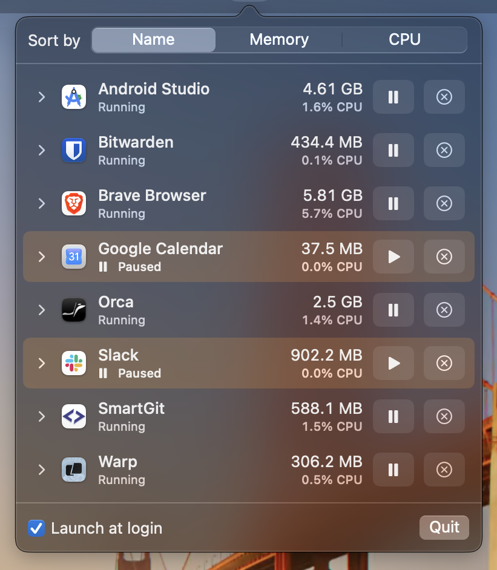

# Stasis

Menu bar utility to pause (`SIGSTOP`) and resume (`SIGCONT`) running macOS apps, and to
recover apps that macOS itself paused under memory pressure.

<p align="center">
  
</p>

Each app row shows its memory footprint and CPU rate; expand a row to see and toggle the
individual processes (browser renderers, JVMs, helpers). Pause state is read from the kernel
process table, so system-initiated pauses show up without the tool having been involved.
The control at the top sorts the list by name, memory or CPU; the choice is remembered.

The ✕ at the end of a row kills the app or process with `SIGKILL` (paused processes ignore
anything gentler). It takes two clicks: the first arms it, moving the pointer away disarms it.

Pausing frees CPU, not RAM. A paused app keeps its memory until the compressor or swap takes it.

## Build and run

Requires macOS 14+. `make test` and `make build` need only the Xcode command line tools
(Swift 6); `make run` and `make install` need full Xcode 26+ because the app icon is compiled
from an Icon Composer document with `actool`.

```
make test      # unit tests for the grouping / state / signal / matching / sorting / CPU logic
make run       # build release, assemble build/Stasis.app, launch it
make install   # same, then copy to /Applications, symlink the CLI, launch
make raycast   # npm install + register the Raycast extension (see below)
```

The `.app` wrapper is assembled by the Makefile from `Info.plist` and the compiled
`Resources/AppIcon.icon`, then ad-hoc signed; there is no Xcode project. `swift run Stasis`
works for quick iteration but shows a Dock icon and cannot register launch-at-login, since both
need the bundle.

## Command line

The bundle carries a CLI at `Stasis.app/Contents/Helpers/stasis`; `make install` symlinks it to
`/opt/homebrew/bin/stasis` (override with `BIN=`). It works whether or not the menu bar app is
running and pokes the app to refresh its icon after a change.

```
stasis list [--json] [--processes]      apps with state and memory; JSON is what Raycast reads
stasis pause <app> / resume <app>       bundle id or name, case-insensitive; a partial name
                                        needs 3+ characters and must match exactly one app
stasis kill <app>                       SIGKILL to the app and its processes, no confirmation
stasis pause-all [--include-frontmost]  spares the app in front unless told otherwise
stasis resume-all
```

Exit status: 1 usage, 2 no or ambiguous app (candidates on stderr), 3 some signal failed.

## Raycast

`raycast/` is a Raycast extension with three commands: Pause / Resume Apps (every app with
memory and state, Enter pauses a running app or resumes a paused one, the row stays put), Pause
All Apps and Resume All Apps, which are also actions inside the first. The list also has a Kill
action (⌃X) that asks before it kills. It shells out to the CLI at its
bundle path, so Stasis must be installed in `/Applications`. Needs Node; `make raycast` installs
the npm dependencies and starts Raycast's dev server, which registers the extension. Stop the
server once the commands appear in Raycast, they stay registered. Re-run it after changing the
extension's source.

## Notes

- Finder, Dock, Raycast and Stasis itself are hidden from the list. Raycast because a paused
  launcher could not run the resume command.
- Processes of other users cannot be signalled without root; the footer shows the error.
- Sampling: every 2 s while the popover is open, every 30 s otherwise (keeps the menu bar icon
  in sync when the system pauses something).

## License

[Apache-2.0](LICENSE). The Raycast extension in `raycast/` is [MIT](raycast/LICENSE), the only
license Raycast accepts for extensions.
